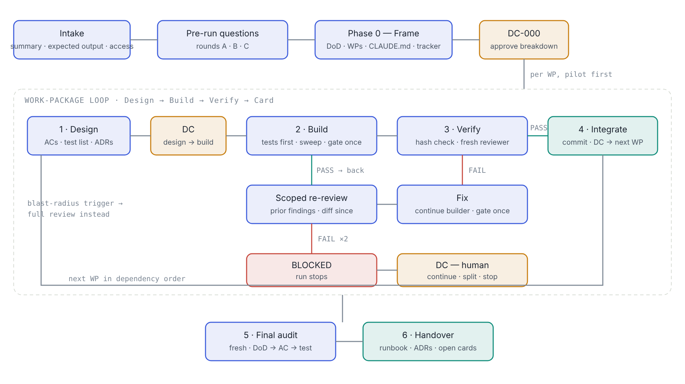
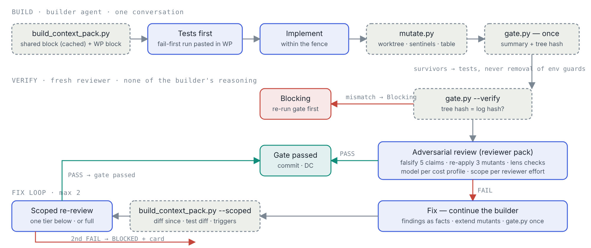

# Claude skills — execution-playbook

A gated execution playbook for Claude: any multi-step build task is cut into work packages, each designed, built tests-first, verified by gate commands and a fresh adversarial reviewer, and closed with a Decision Card.

## The concept

An AI coding agent will happily keep building on its own mistakes. It writes verified and guessed things in the same confident tone, it convinces itself its code is right, and the cost of a wrong decision compounds with every step that follows it. The playbook does not try to make the agent more careful; it puts structure around it so that mistakes are caught at a boundary instead of discovered three packages later.

Four ideas carry the whole method:

- **Gates decide when to stop and check.** Work is cut into packages small enough to design, build and verify in one sitting each. A package passes only when its gate commands are green *and* an independent review says so. Two fix loops, then it is BLOCKED and a human decides. A gate is never weakened to pass.
- **Build in one context, attack in another.** The session that wrote the code has already convinced itself it is right, so the reviewer is always a fresh context with the acceptance criteria, the lenses and the code — and none of the builder's reasoning. The reviewer's job is to fail the package if it can.
- **Tags show what is proven.** Every claim in every record carries its status inline: `[src:]` backed by code or spec, `[GAP]` not known and not guessed, `[DRIFT]` two sources disagree, `[PLANNED]` deferred on purpose, `[UNTESTED]` no test proves it. Nothing is invented to sound complete; a gap is cheaper than a wrong default.
- **Decision Cards record why, while the answer is still known.** At every phase boundary the person (or, unattended, a fixed rule set) decides with the gate's evidence in front of them: what was done, what the reviewer found, the options with their cost and reversibility, a recommendation, and the default if nobody answers. Non-obvious technical choices become ADRs at the same moment.

Everything else in the skill is cost control that does not touch those four: context packs instead of reading lists, a mutation harness instead of hand steps, structured gate summaries instead of pasted logs, per-stage call budgets, fix-by-continuation with a scoped re-review, and model tiers chosen per stage. Each of those carries a mechanical guard so a cheaper run cannot pass as a thorough one.

## What you get from it

- **First-time quality instead of fix loops.** Tests are written before code and must fail first; the builder mutates every conditional, boundary and fallback it added and proves a test catches each one; detectors are proven through the real path. In the run that shaped these rules, first-review failures went from 6 of 7 packages to passing or one finding once the self-check was in.
- **Findings you can act on.** A review is a table of numbered findings with severity, lens, evidence and the acceptance criterion affected — not a prose "looks fine". A Decision Card is a one-line answer away from resuming the run.
- **Resumable, unattended runs.** The tracker's "next action" line, the run config and the logs are what a returning person or a fresh session reads; a run can stop at any card and continue days later, and a changed spec triggers a delta round rather than a rebuild.
- **Scope on a dial, rigor fixed.** Fidelity (POC / MVP / Full), effort on logic, architecture and UI, cost profile, reviewer effort and self-check level change how much is in scope and how hard it is checked. None of them changes that tests come first, the reviewer is fresh, gaps are tagged, and a gate is never weakened for what is in scope.
- **Cost that is measured, not assumed.** The tracker reports first-review pass rate, tool calls per stage against the cap, review tokens first → re-review, mutants listed and survived, fixes continued vs fresh. The baseline run cost $93–120 with about 85% of spend on helpers re-reading context; the cost rules target roughly half of that, and the tracker is how you find out whether they did.
- **A record that survives the people.** PLAYBOOK.md, the work-package files, ADRs, Decision Cards, GAP and RISK logs and the review files are the project's memory: anyone can see what was built, what was decided and why, what is unknown, and what was deliberately left for later.

## Install

**Claude.ai / Claude desktop** — upload `execution-playbook.skill` under Settings → Capabilities → Skills → Upload skill. (Team/Enterprise owners can provision it organisation-wide from Admin settings.)

**Claude Code, per repository** — copy `skills/execution-playbook/` into your repo as `.claude/skills/execution-playbook/` and commit; everyone who clones the repo gets it.

**Claude Code, personal** — copy it to `~/.claude/skills/execution-playbook/`.

## How a run flows

Open [`docs/execution-flow.html`](docs/execution-flow.html) for the interactive page (level of detail, guards table, model per stage, PNG export). The two diagrams:

**One run, end to end** — intake and the three question rounds, Phase 0 and DC-000, the work-package loop with its fix / scoped re-review branch and BLOCKED exit, then the final audit and handover.

**Inside one work package** — Build (context pack → tests first → implement → mutation harness → one gate run) and Verify (tree-hash check → fresh adversarial review), with the fix loop that continues the builder and re-reviews only what changed. Dashed boxes are scripts that ship with the skill.

Dark-theme versions: [`execution-flow-overview-dark.png`](docs/execution-flow-overview-dark.png), [`work-package-loop-dark.png`](docs/work-package-loop-dark.png).

## What is in the skill

| Path | Purpose |
|---|---|
| `SKILL.md` | How the skill runs: intake, pre-run questions (fidelity, effort, mode, format, cost profile, tooling, reviewer effort, self-check), the per-WP loop, finishing and resuming |
| `references/playbook-core.md` | Principles, tags, phases with prompts, gates, decision rules, model guide, templates |
| `references/intake-and-fidelity.md` | Mandatory summary, expected output, technology suggestion, fidelity levels, effort dimensions, tooling plan |
| `references/cost-and-orchestration.md` | Model/effort ladders, cost profiles, the orchestrator loop |
| `references/review-depth.md` | Reviewer effort levels and context packs |
| `references/self-check.md` | Build self-check: mutation sweep, control tests, derived test budget |
| `references/step-budgets.md` | Per-stage call caps, harness, structured gate summaries, one gate run per stage, measured baseline |
| `references/review-lenses.md`, `references/decision-cards.md` | Reviewer lens catalog; Decision Card format and triggers |
| `scripts/build_tracker.py` | run-config → tracker + usage guide (MD/HTML) |
| `scripts/build_decision_card.py` | Decision Card JSON → MD/HTML + register |
| `scripts/build_context_pack.py` | Shared / builder / reviewer packs; `--scoped` re-review packs with blast-radius triggers |
| `scripts/gate.py` | Runs gate commands once; structured summary stamped with the tree hash; `--verify`, `--show` |
| `scripts/mutate.py` | Mutation harness: worktree per mutant, baseline guard, sentinels |
| `scripts/render_html.py` | Markdown → HTML pages |
| `assets/` | Example run config and decision card |

Scripts need Python 3.10+ and git; `render_html.py` needs `pip install markdown`.

## Trying it

Point Claude at a repository and say "run the execution playbook on this". The skill asks its questions, generates `_playbook/TRACKER.md` and `_playbook/USAGE.md`, and starts Phase 0.
