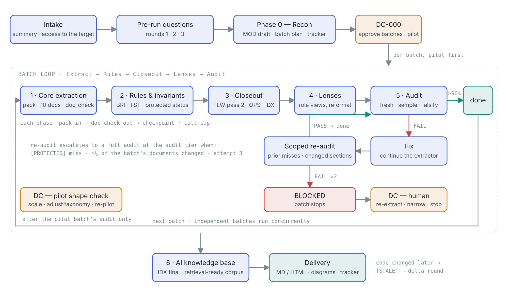
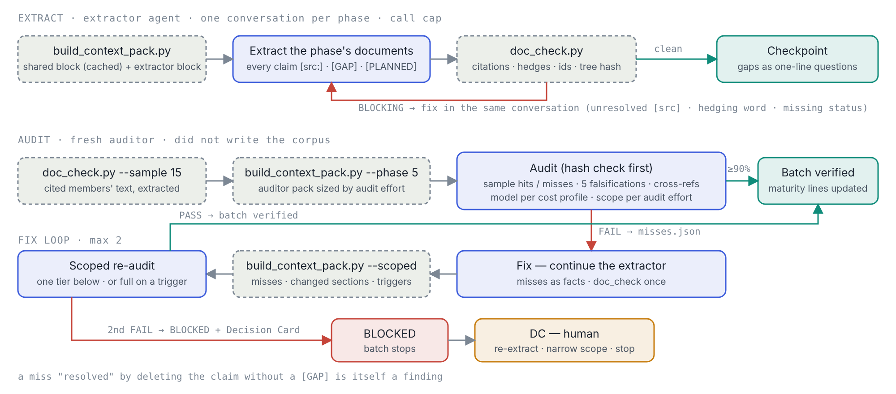

# Claude playbook skills

Two Claude skills that share one idea: an AI agent's work should carry its evidence, stop at boundaries to be checked by a context that did not produce it, and record decisions while the reason is still known.

| Skill | Use it when | Package |
|---|---|---|
| [**execution-playbook**](#execution-playbook) | you want something *built* — software, migrations, pipelines, anything cut into work packages with acceptance criteria | [`execution-playbook.skill`](execution-playbook.skill) |
| [**documentation-playbook**](#documentation-playbook) | you want an *existing* system documented — architecture, data, business rules and invariants, flows, per-role views, an AI knowledge base — with every claim traceable to code | [`documentation-playbook.skill`](documentation-playbook.skill) |

Both ask the same kind of questions before starting (execution mode, output format, cost profile, checking effort), both run as an orchestrator launching phase agents on the model each phase deserves, and both ship scripts whose job is to make the cheap path mechanically honest. A system documented with one is the natural input to the other.

## Install

**Claude.ai / Claude desktop** — upload the `.skill` file under Settings → Capabilities → Skills → Upload skill. (Team/Enterprise owners can provision it organisation-wide from Admin settings.)

**Claude Code, per repository** — copy `skills/<name>/` into your repo as `.claude/skills/<name>/` and commit; everyone who clones the repo gets it.

**Claude Code, personal** — copy it to `~/.claude/skills/<name>/`.

Scripts need Python 3.10+ and git; `render_html.py` needs `pip install markdown`.

---

# execution-playbook

A gated execution playbook for Claude: any multi-step build task is cut into work packages, each designed, built tests-first, verified by gate commands and a fresh adversarial reviewer, and closed with a Decision Card.

## The concept

An AI coding agent will happily keep building on its own mistakes. It writes verified and guessed things in the same confident tone, it convinces itself its code is right, and the cost of a wrong decision compounds with every step that follows it. The playbook does not try to make the agent more careful; it puts structure around it so that mistakes are caught at a boundary instead of discovered three packages later.

Four ideas carry the whole method:

- **Gates decide when to stop and check.** Work is cut into packages small enough to design, build and verify in one sitting each. A package passes only when its gate commands are green *and* an independent review says so. Two fix loops, then it is BLOCKED and a human decides. A gate is never weakened to pass.
- **Build in one context, attack in another.** The session that wrote the code has already convinced itself it is right, so the reviewer is always a fresh context with the acceptance criteria, the lenses and the code — and none of the builder's reasoning. The reviewer's job is to fail the package if it can.
- **Tags show what is proven.** Every claim in every record carries its status inline: `[src:]` backed by code or spec, `[GAP]` not known and not guessed, `[DRIFT]` two sources disagree, `[PLANNED]` deferred on purpose, `[UNTESTED]` no test proves it. Nothing is invented to sound complete; a gap is cheaper than a wrong default.
- **Decision Cards record why, while the answer is still known.** At every phase boundary the person (or, unattended, a fixed rule set) decides with the gate's evidence in front of them: what was done, what the reviewer found, the options with their cost and reversibility, a recommendation, and the default if nobody answers. Non-obvious technical choices become ADRs at the same moment.

Everything else in the skill is cost control that does not touch those four: context packs instead of reading lists, a mutation harness instead of hand steps, structured gate summaries instead of pasted logs, per-stage call budgets, fix-by-continuation with a scoped re-review, and model tiers chosen per stage. Each of those carries a mechanical guard so a cheaper run cannot pass as a thorough one.

## What you get from it

- **First-time quality instead of fix loops.** Tests are written before code and must fail first; the builder mutates every conditional, boundary and fallback it added and proves a test catches each one; detectors are proven through the real path. In the run that shaped these rules, first-review failures went from 6 of 7 packages to passing or one finding once the self-check was in.
- **Findings you can act on.** A review is a table of numbered findings with severity, lens, evidence and the acceptance criterion affected — not a prose "looks fine". A Decision Card is a one-line answer away from resuming the run.
- **Resumable, unattended runs.** The tracker's "next action" line, the run config and the logs are what a returning person or a fresh session reads; a run can stop at any card and continue days later, and a changed spec triggers a delta round rather than a rebuild.
- **Scope on a dial, rigor fixed.** Fidelity (POC / MVP / Full), effort on logic, architecture and UI, cost profile, reviewer effort and self-check level change how much is in scope and how hard it is checked. None of them changes that tests come first, the reviewer is fresh, gaps are tagged, and a gate is never weakened for what is in scope.
- **Cost that is measured, not assumed.** The tracker reports first-review pass rate, tool calls per stage against the cap, review tokens first → re-review, mutants listed and survived, fixes continued vs fresh. The baseline run cost $93–120 with about 85% of spend on helpers re-reading context; the cost rules target roughly half of that, and the tracker is how you find out whether they did.
- **A record that survives the people.** PLAYBOOK.md, the work-package files, ADRs, Decision Cards, GAP and RISK logs and the review files are the project's memory: anyone can see what was built, what was decided and why, what is unknown, and what was deliberately left for later.

## How a run flows

Open [`docs/execution-flow.html`](docs/execution-flow.html) for the interactive page (level of detail, guards table, model per stage, PNG export). The two diagrams:

**One run, end to end** — intake and the three question rounds, Phase 0 and DC-000, the work-package loop with its fix / scoped re-review branch and BLOCKED exit, then the final audit and handover.

**Inside one work package** — Build (context pack → tests first → implement → mutation harness → one gate run) and Verify (tree-hash check → fresh adversarial review), with the fix loop that continues the builder and re-reviews only what changed. Dashed boxes are scripts that ship with the skill.

Dark-theme versions: [`execution-flow-overview-dark.png`](docs/execution-flow-overview-dark.png), [`work-package-loop-dark.png`](docs/work-package-loop-dark.png).

## What is in the skill

| Path | Purpose |
|---|---|
| `SKILL.md` | How the skill runs: intake, pre-run questions (fidelity, effort, mode, format, cost profile, tooling, reviewer effort, self-check), the per-WP loop, finishing and resuming |
| `references/playbook-core.md` | Principles, tags, phases with prompts, gates, decision rules, model guide, templates |
| `references/intake-and-fidelity.md` | Mandatory summary, expected output, technology suggestion, fidelity levels, effort dimensions, tooling plan |
| `references/cost-and-orchestration.md` | Model/effort ladders, cost profiles, the orchestrator loop |
| `references/review-depth.md` | Reviewer effort levels and context packs |
| `references/self-check.md` | Build self-check: mutation sweep, control tests, derived test budget |
| `references/step-budgets.md` | Per-stage call caps, harness, structured gate summaries, one gate run per stage, measured baseline |
| `references/review-lenses.md`, `references/decision-cards.md` | Reviewer lens catalog; Decision Card format and triggers |
| `scripts/build_tracker.py` | run-config → tracker + usage guide (MD/HTML) |
| `scripts/build_decision_card.py` | Decision Card JSON → MD/HTML + register |
| `scripts/build_context_pack.py` | Shared / builder / reviewer packs; `--scoped` re-review packs with blast-radius triggers |
| `scripts/gate.py` | Runs gate commands once; structured summary stamped with the tree hash; `--verify`, `--show` |
| `scripts/mutate.py` | Mutation harness: worktree per mutant, baseline guard, sentinels |
| `scripts/render_html.py` | Markdown → HTML pages |
| `assets/` | Example run config and decision card |

## Trying it

Point Claude at a repository and say "run the execution playbook on this". The skill asks its questions, generates `_playbook/TRACKER.md` and `_playbook/USAGE.md`, and starts Phase 0.

---

# documentation-playbook

A phased, traceable documentation playbook for Claude: an existing system — legacy or new, any stack — is documented in batches of modules, every claim tagged with its evidence, every extraction phase closed by a mechanical check, every batch audited by a fresh context, and the pilot batch proven before the rest is scaled.

## The concept

Documentation written by an AI agent fails in a particular way: it reads well, it is mostly right, and nobody can tell which parts are the "mostly". A summary the agent was given becomes a fact; a reasonable guess about a rule becomes the rule; a file that changed last week is still described as it was. The playbook does not ask the agent to be more careful — it makes the evidence trail part of the document, and checks it mechanically and adversarially before anyone reads it.

Four ideas carry the method:

- **Every claim carries its evidence.** `[src: File#Member]` when the code says so, `[GAP]` when it could not be confirmed (nothing invented), `[DRIFT]` when two sources disagree (both sides stated, neither picked), `[PLANNED]` when it is intentionally not built, `[UNTESTED]` when no test proves it. Hedging words are not allowed: a sentence is either evidenced or a gap. A reader sees in the line itself how much to trust it.
- **Fourteen documents, seven phases, batches of modules.** Architecture, data, modules, interfaces, integrations, cross-cutting concerns, conventions, UX flows, business flows, rules and invariants, test coverage, operations, dependencies and an index — each built in the phase that has the evidence for it (recon → core extraction → rules and invariants → closeout → role lenses → audit → AI knowledge base). Business rules and invariants are their own phase on the strongest model because they are the hardest claims to catch wrong later, and seeded `[PROTECTED]` invariants get an explicit MATCH / DRIFT / UNVERIFIED status each.
- **Check mechanically, then audit in a fresh context.** `doc_check.py` runs after every extraction phase: every citation must resolve to a real file and member, gap and drift ids must reconcile with the logs, every protected rule needs a status, every diagram element needs a tag. Then a Phase 5 auditor that did not write the corpus re-opens a random sample of citations against the code and tries to falsify the strongest claims. Below 90% hits, the batch is fixed and re-audited; two failures and it is BLOCKED for a human.
- **Pilot first, Decision Cards at the turns.** The first batch proves the document shape before the remaining batches are scaled; its audit closes with a Decision Card (scale, adjust the taxonomy, re-pilot). A drift on a protected invariant, an audit miss on a protected claim, a blocked batch or a mid-run change of profile raise one too — with the evidence, the options and a default, so an unattended run can continue and a returning person can see why.

Everything else is cost control that does not touch those four: output profiles (full, 30-minute read, 10-minute read; documents, diagrams or both; static or interactive diagrams at three depths), context packs instead of reading lists, one check per phase stamped with the code's tree hash, per-phase call budgets, fix-by-continuation with a scoped re-audit, audit effort on a dial, and model tiers per phase.

## What you get from it

- **Documents you can trust line by line.** Not "the docs are good" but "this claim is backed by that member, this one is a gap, these two sources disagree". The GAP log is a question list for the system's owners; the DRIFT log is a list of decisions nobody has made yet.
- **Role views without duplicated content.** Architect, Developer, QA and BA lenses by default (Operations, Security, Data, Product, Support, Integration, Migration and Audit on request) are entry pages that route a role to the sections it needs, with their own concerns answered — one corpus, several front doors.
- **A corpus an AI can answer from.** Phase 6 packages the audited documents into a retrieval-ready knowledge base that inherits the evidence trail, so an assistant answering "what happens when a risk result is HIGH" cites the rule, its source and its test — or says it is a gap.
- **Scope on a dial, rigor fixed.** Depth, content mode, diagram depth, cost profile and audit effort change how much is written and how hard it is checked. None of them changes that claims carry evidence, the auditor is fresh, gaps are logged instead of guessed, and a protected invariant is never silently rewritten.
- **Runs that survive interruption and code change.** The tracker's "next action" line, the run config and the logs are what a returning person or a fresh session reads. When the code changes later, a delta round marks affected citations `[STALE]` and re-runs only the phases that touch the changed modules.
- **Cost that is measured.** The tracker reports citation hit rate first audit → re-audit, calls per phase against the cap, unresolved citations and hedges caught before the auditor, and open gaps by severity — so a budget run is visibly a budget run.

## How a run flows

Open [`docs/documentation-flow.html`](docs/documentation-flow.html) for the interactive page (question rounds, guards table, model per phase, the 14-document taxonomy, PNG export). The two diagrams:

**One run, end to end** — intake and the three question rounds, Phase 0 and DC-000, the batch loop (core extraction → rules and invariants → closeout → lenses → audit) with its fix / scoped re-audit branch, the pilot shape check, and the knowledge-base packaging.

**Inside one batch** — Extract (context pack → documents → `doc_check.py` → checkpoint), Audit (citation sample with the cited code → auditor pack sized by audit effort → fresh audit), and the fix loop that continues the extractor and re-audits only what changed. Dashed boxes are scripts that ship with the skill.

Dark-theme versions: [`documentation-flow-overview-dark.png`](docs/documentation-flow-overview-dark.png), [`documentation-batch-loop-dark.png`](docs/documentation-batch-loop-dark.png).

## What is in the skill

| Path | Purpose |
|---|---|
| `SKILL.md` | How the skill runs: optional intake, three question rounds (mode, format, cost profile, lenses; depth, content, diagram style and depth; audit effort), the orchestrator rules, finishing and resuming |
| `references/playbook-core.md` | The methodology: principles, 14-document taxonomy, header convention, tags, the seven phases with their prompts, model guide, scoped re-audit, delta rounds |
| `references/lenses.md` | Default lenses and the optional catalog, with the shape for a custom one |
| `references/cost-and-orchestration.md` | Model/effort ladders, cost profiles, the orchestrator loop |
| `references/output-profiles.md` | Depth, content mode, diagram style and depth; the D1–D10 diagram taxonomy |
| `references/audit-and-packs.md` | Audit effort levels with cost and effect, context packs, the mechanical check, scoped re-audit, call budgets, Decision Card triggers, measurement |
| `scripts/build_tracker.py` | run-config → tracker + usage guide (MD/HTML) |
| `scripts/doc_check.py` | The mechanical check: citations, hedges, id reconciliation, protected statuses, headers, diagram tags; `--sample N` extracts cited members for the auditor; tree-hashed |
| `scripts/build_context_pack.py` | Shared / extractor / auditor packs; `--scoped` re-audit packs with escalation triggers |
| `scripts/build_decision_card.py` | Decision Card JSON → MD/HTML + register |
| `scripts/render_html.py` | Markdown corpus → HTML pages with index, tag highlighting and Mermaid rendering |
| `scripts/build_diagram_page.py` | Diagram JSON → one interactive page: pan/zoom, click-to-evidence, level switch, tag filter, lens toggle |
| `assets/` | Example run config, decision card and diagram set |

## Trying it

Point Claude at a codebase and say "document this system with the documentation playbook". The skill asks its questions, generates `_playbook/TRACKER.md` and `_playbook/USAGE.md`, runs Phase 0 and proposes the batch plan and pilot as DC-000.
